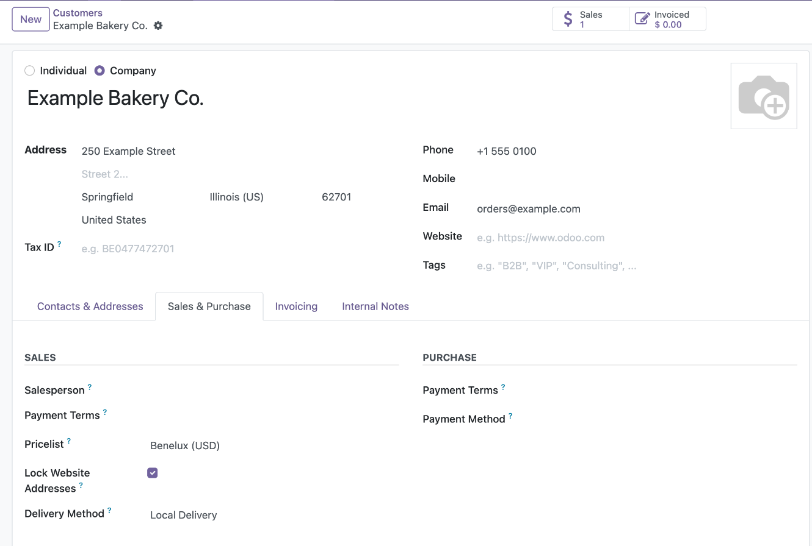
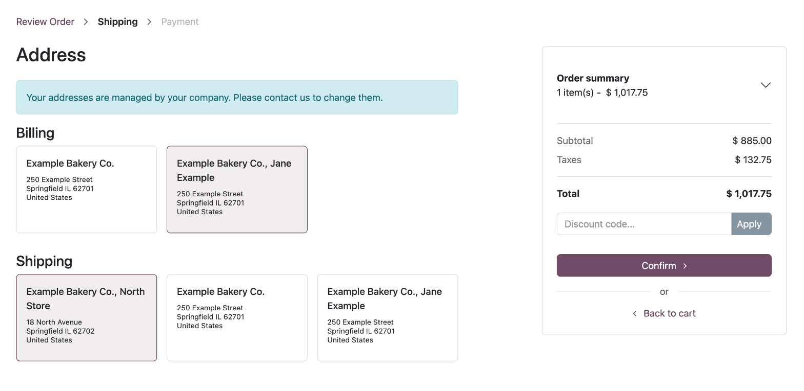
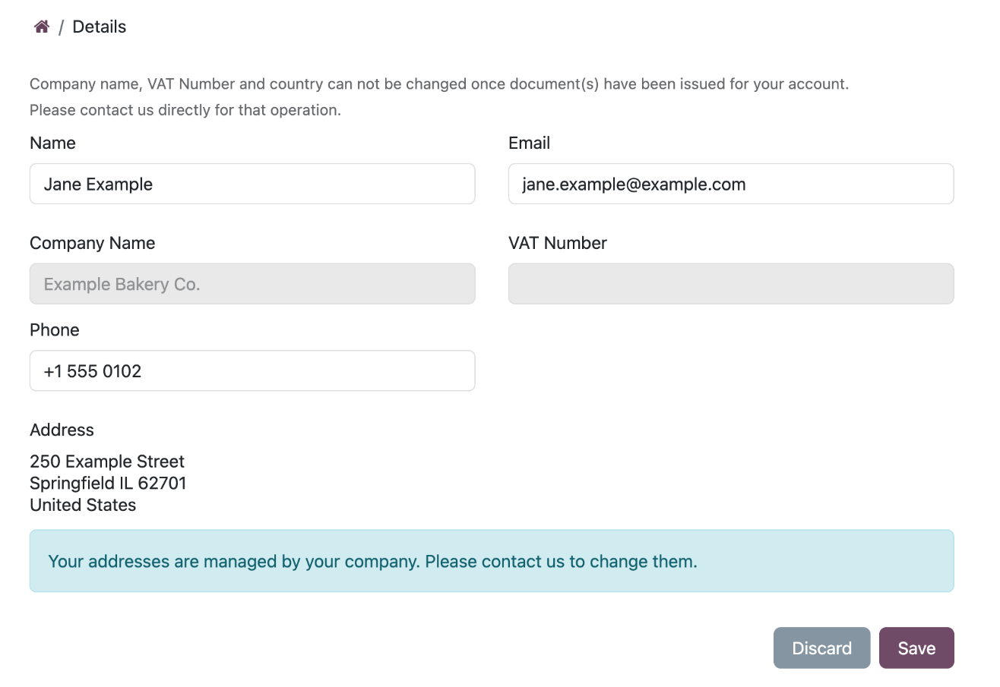

.. image:: https://odoo-community.org/readme-banner-image
   :target: https://odoo-community.org/get-involved?utm_source=readme
   :alt: Odoo Community Association

=========================
Website Sale Address Lock
=========================

.. 
   !!!!!!!!!!!!!!!!!!!!!!!!!!!!!!!!!!!!!!!!!!!!!!!!!!!!
   !! This file is generated by oca-gen-addon-readme !!
   !! changes will be overwritten.                   !!
   !!!!!!!!!!!!!!!!!!!!!!!!!!!!!!!!!!!!!!!!!!!!!!!!!!!!
   !! source digest: sha256:1bbd9d603ae292ad245f794afd87400d09344c728a7da5ccbe719e321104cdc5
   !!!!!!!!!!!!!!!!!!!!!!!!!!!!!!!!!!!!!!!!!!!!!!!!!!!!

.. |badge1| image:: https://img.shields.io/badge/maturity-Beta-yellow.png
    :target: https://odoo-community.org/page/development-status
    :alt: Beta
.. |badge2| image:: https://img.shields.io/badge/license-AGPL--3-blue.png
    :target: http://www.gnu.org/licenses/agpl-3.0-standalone.html
    :alt: License: AGPL-3
.. |badge3| image:: https://img.shields.io/badge/github-OCA%2Fe--commerce-lightgray.png?logo=github
    :target: https://github.com/OCA/e-commerce/tree/17.0/website_sale_address_lock
    :alt: OCA/e-commerce
.. |badge4| image:: https://img.shields.io/badge/weblate-Translate%20me-F47D42.png
    :target: https://translation.odoo-community.org/projects/e-commerce-17-0/e-commerce-17-0-website_sale_address_lock
    :alt: Translate me on Weblate
.. |badge5| image:: https://img.shields.io/badge/runboat-Try%20me-875A7B.png
    :target: https://runboat.odoo-community.org/builds?repo=OCA/e-commerce&target_branch=17.0
    :alt: Try me on Runboat

|badge1| |badge2| |badge3| |badge4| |badge5|

This module adds a *Lock Website Addresses* option to customers. When it
is set on a customer, neither the customer nor any of its contacts can
add or edit addresses in the website checkout or in the customer portal.
In the checkout they can only choose one of the addresses the customer
already has.

The lock covers billing and shipping addresses. The name, email and
phone of the contact can still be completed from the portal.

**Table of contents**

.. contents::
   :local:

Use Cases / Context
===================

Some businesses sell to franchises or branches whose delivery addresses
are approved centrally. Their users must order only to those addresses,
while they keep their own email and phone up to date.

Configuration
=============

To lock the addresses of a customer:

1. Go to *Website > eCommerce > Customers* and open the customer.
2. In the *Sales & Purchase* tab, *Sales* group, check *Lock Website
   Addresses* and save.

|Lock Website Addresses|

The option is shown on companies and on contacts without a parent
company, and it applies to all the contacts of that customer.

Users of a locked customer cannot fill in missing address data, so the
required address fields must be completed from the backend.

Usage
=====

When a portal user of a locked customer goes through the checkout:

1. The address cards have no *Edit* button, there is no *Add address*
   button and a message says that the addresses are managed by the
   company. Another existing address can still be selected.
2. If the contact of the user only lacks name, email or phone, the
   checkout redirects to the portal details page to complete them.
3. In any other case where an address lacks required data, the checkout
   shows a warning and the order cannot be confirmed.

|Locked checkout|

In the portal, *Edit information* opens the details page
(*/my/account*). The address is shown as text and is never written,
while the name, email and phone can be changed.

|Portal details page|

Known issues / Roadmap
======================

- The lock is set on the customer. Locking or unlocking a single contact
  apart from its customer is not available.
- If the contact of a locked user has no street, city or country, the
  portal details page cannot be saved ("Some required fields are
  empty.") until the address is completed from the backend.

Bug Tracker
===========

Bugs are tracked on `GitHub Issues <https://github.com/OCA/e-commerce/issues>`_.
In case of trouble, please check there if your issue has already been reported.
If you spotted it first, help us to smash it by providing a detailed and welcomed
`feedback <https://github.com/OCA/e-commerce/issues/new?body=module:%20website_sale_address_lock%0Aversion:%2017.0%0A%0A**Steps%20to%20reproduce**%0A-%20...%0A%0A**Current%20behavior**%0A%0A**Expected%20behavior**>`_.

Do not contact contributors directly about support or help with technical issues.

Credits
=======

Authors
-------

* Binhex

Contributors
------------

- `Binhex <https://www.binhex.cloud>`__:

  - Edilio Escalona Almira <e.escalona@binhex.cloud>

Maintainers
-----------

This module is maintained by the OCA.

.. image:: https://odoo-community.org/logo.png
   :alt: Odoo Community Association
   :target: https://odoo-community.org

OCA, or the Odoo Community Association, is a nonprofit organization whose
mission is to support the collaborative development of Odoo features and
promote its widespread use.

This module is part of the `OCA/e-commerce <https://github.com/OCA/e-commerce/tree/17.0/website_sale_address_lock>`_ project on GitHub.

You are welcome to contribute. To learn how please visit https://odoo-community.org/page/Contribute.
