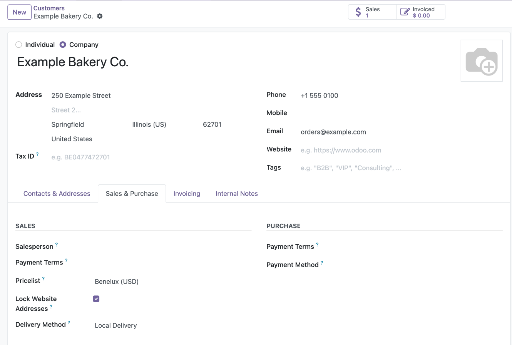

To lock the addresses of a customer:

1.  Go to *Website \> eCommerce \> Customers* and open the customer.
2.  In the *Sales & Purchase* tab, *Sales* group, check *Lock Website
    Addresses* and save.

The option is shown on companies and on contacts without a parent
company, and it applies to all the contacts of that customer.

Users of a locked customer cannot fill in missing address data, so the
required address fields must be completed from the backend.
