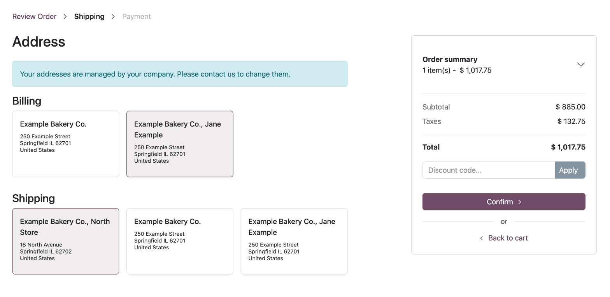
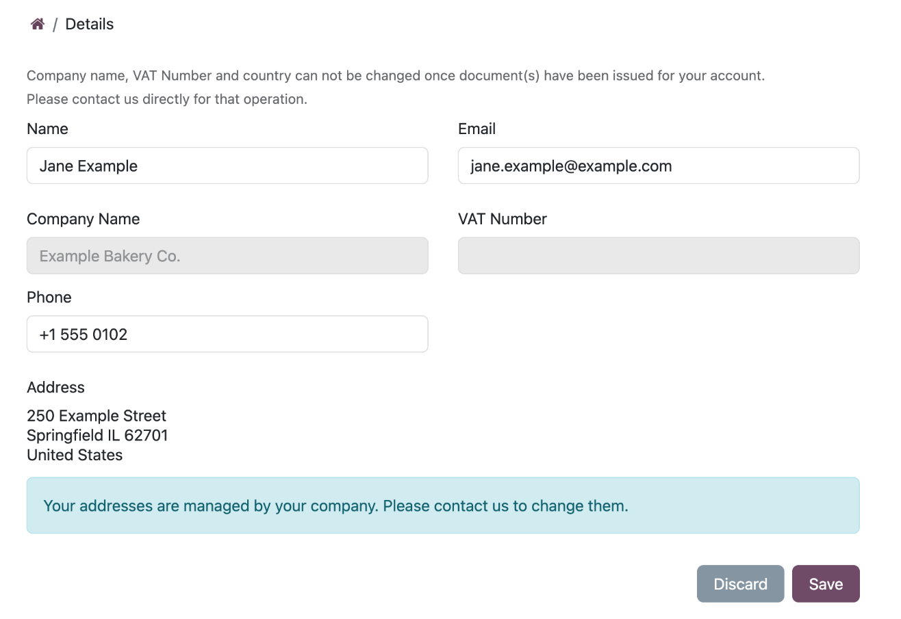

When a portal user of a locked customer goes through the checkout:

1.  The address cards have no *Edit* button, there is no *Add address*
    button and a message says that the addresses are managed by the
    company. Another existing address can still be selected.
2.  If the contact of the user only lacks name, email or phone, the
    checkout redirects to the portal details page to complete them.
3.  In any other case where an address lacks required data, the
    checkout shows a warning and the order cannot be confirmed.

In the portal, *Edit information* opens the details page
(*/my/account*). The address is shown as text and is never written,
while the name, email and phone can be changed.

